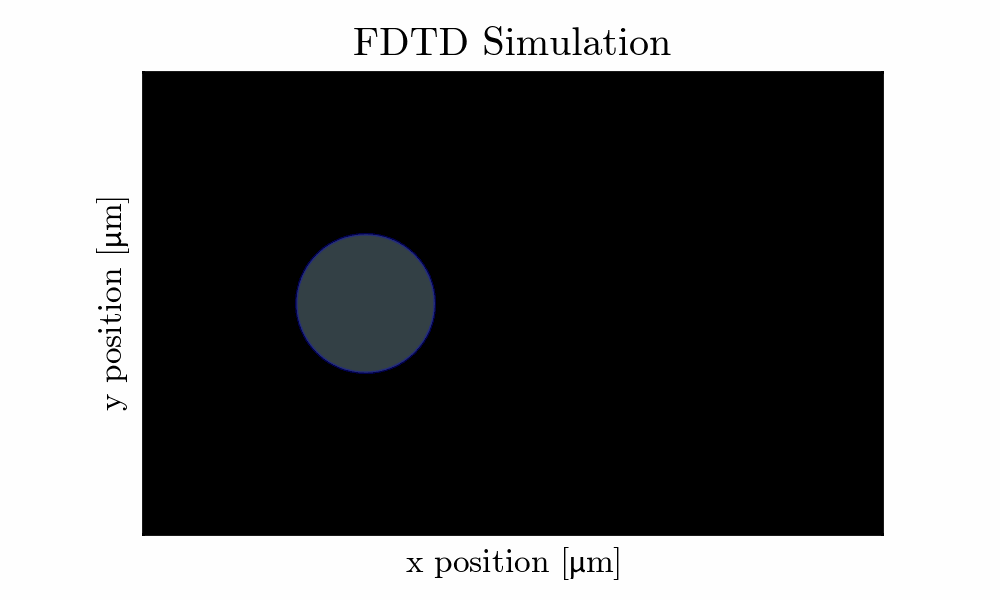

LightWave2D
===========

.. list-table::
   :width: 100%
   :widths: 35 65
   :header-rows: 1

   * - Badge
     - Status
   * - Python versions
     - |mps-python|
   * - Documentation
     - |mps-docs|
   * - Tests
     - |mps-ci| |mps-coverage|
   * - PyPI
     - |mps-pypi| |mps-downloads|
   * - Conda
     - |mps-conda| |mps-conda-downloads| |mps-conda-release|

A package for finite-difference time-domain simulation of light propagation.

Set the grid, material boundaries, source, and absorbing layers to model propagation
of an electromagnetic pulse in two dimensions. The circular-scatterer example shows
the incident and scattered waves evolving together.

See the `usage guide <https://github.com/MartinPdeS/LightWave2D/blob/HEAD/USAGE.rst>`__ for further examples and implementation details.

Installation
------------

Requires Python ``>=3.10``.

.. code-block:: console

   $ python -m pip install LightWave2D

Install from the ``martinpdes`` Conda channel:

.. code-block:: console

   $ conda install -c martinpdes lightwave2d

For an editable source installation:

.. code-block:: console

   $ git clone https://github.com/MartinPdeS/LightWave2D.git
   $ cd LightWave2D
   $ python -m pip install -e .

Scatter a wave from a circular inclusion
----------------------------------------

.. code-block:: python

   """
   Circular Scatterer
   ==================

   This example demonstrates the setup and execution of a circular scatterer experiment using LightWave2D.
   We will define the simulation grid, add a circular scatterer and a line source, apply a perfectly matched layer (PML), run the simulation, and visualize the results.
   """

   # %%
   from LightWave2D.grid import Grid
   from LightWave2D.experiment import Experiment
   from MPSPlots import colormaps
   from TypedUnit import ureg

   grid = Grid(
       resolution=0.03 * ureg.micrometer,
       size_x=32 * ureg.micrometer,
       size_y=20 * ureg.micrometer,
       n_steps=500,
   )

   experiment = Experiment(grid=grid)

   scatterer = experiment.add_circle(
       position=("30%", "50%"),  # Center position of the scatterer
       epsilon_r=1.5,  # Relative permittivity of the scatterer
       radius=3 * ureg.micrometer,
       sigma=0 * (ureg.siemens / ureg.meter),  # Conductivity of the scatterer
   )

   source = experiment.add_line_source(
       wavelength=1550 * ureg.nanometer,
       position_0=("10%", "80%"),  # Starting position of the source
       position_1=("10%", "20%"),  # Ending position of the source
       amplitude=10,  # Amplitude of the source
   )

   experiment.add_pml(
       order=1,  # Order of the PML polynomial profile
       width="10%",  # Width of the PML region as a percentage of grid size
       sigma_max=5000 * (ureg.siemens / ureg.meter),  # Maximum conductivity for the PML
   )

   experiment.plot()

   experiment.run()

   # %%
   # Render an animation of the field propagation over time
   animation = experiment.render_propagation(
       skip_frame=5,  # Number of frames to skip in the animation
       colormap=colormaps.polytechnique.red_black_blue,  # Colormap for the animation
       enhance_contrast=3,  # Enhance contrast for better visualization
       save_as="./circular_scatterer.gif",  # Save the animation as a GIF file
       fps=30,
   )

   Time evolution of the field around a circular scatterer.

Documentation
-------------

Use the `LightWave2D documentation <https://martinpdes.github.io/LightWave2D/>`__ to work through
examples and look up the inputs and return values of individual functions.

Contributing
------------

Bug reports, worked examples, and documentation corrections are welcome.
To set up a development checkout and run the tests, follow the `contributing guide <https://github.com/MartinPdeS/LightWave2D/blob/HEAD/CONTRIBUTING.md>`__.

Contact
-------

For questions, contact `Martin Poinsinet de Sivry-Houle <mailto:martin.poinsinet.de.sivry@gmail.com?subject=LightWave2D>`__.

License
-------

See the `LightWave2D license <https://github.com/MartinPdeS/LightWave2D/blob/HEAD/LICENSE>`__ for terms of use.

.. |mps-python| image:: https://img.shields.io/pypi/pyversions/lightwave2d.svg
   :alt: Supported Python versions
   :target: https://pypi.org/project/lightwave2d/

.. |mps-pypi| image:: https://img.shields.io/pypi/v/lightwave2d.svg
   :alt: PyPI version
   :target: https://pypi.org/project/lightwave2d/

.. |mps-downloads| image:: https://img.shields.io/pypi/dm/lightwave2d.svg
   :alt: Monthly PyPI downloads
   :target: https://pypistats.org/packages/lightwave2d

.. |mps-docs| image:: https://github.com/MartinPdeS/LightWave2D/actions/workflows/deploy_documentation.yml/badge.svg
   :alt: Documentation
   :target: https://martinpdes.github.io/LightWave2D/

.. |mps-ci| image:: https://github.com/MartinPdeS/LightWave2D/actions/workflows/tests.yml/badge.svg
   :alt: Tests
   :target: https://github.com/MartinPdeS/LightWave2D/actions/workflows/tests.yml

.. |mps-conda| image:: https://anaconda.org/martinpdes/lightwave2d/badges/version.svg
   :alt: Anaconda version
   :target: https://anaconda.org/martinpdes/lightwave2d

.. |mps-conda-downloads| image:: https://anaconda.org/martinpdes/lightwave2d/badges/downloads.svg
   :alt: Anaconda downloads
   :target: https://anaconda.org/martinpdes/lightwave2d

.. |mps-conda-release| image:: https://anaconda.org/martinpdes/lightwave2d/badges/latest_release_relative_date.svg
   :alt: Latest Anaconda release
   :target: https://anaconda.org/martinpdes/lightwave2d
