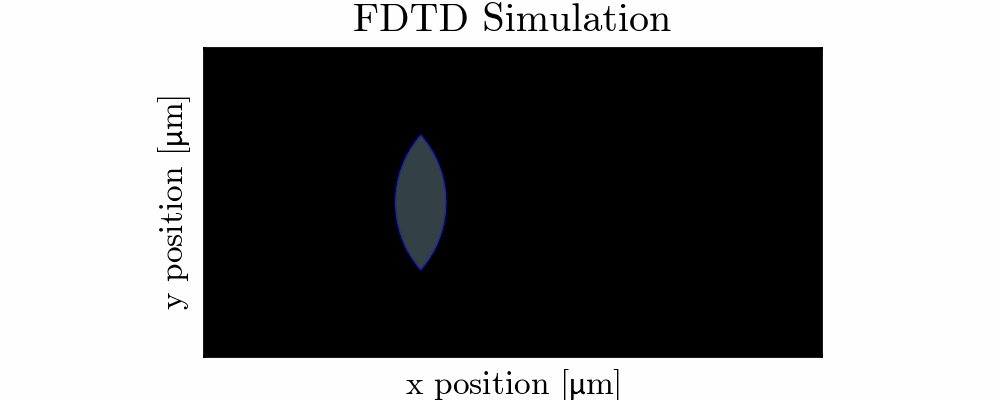
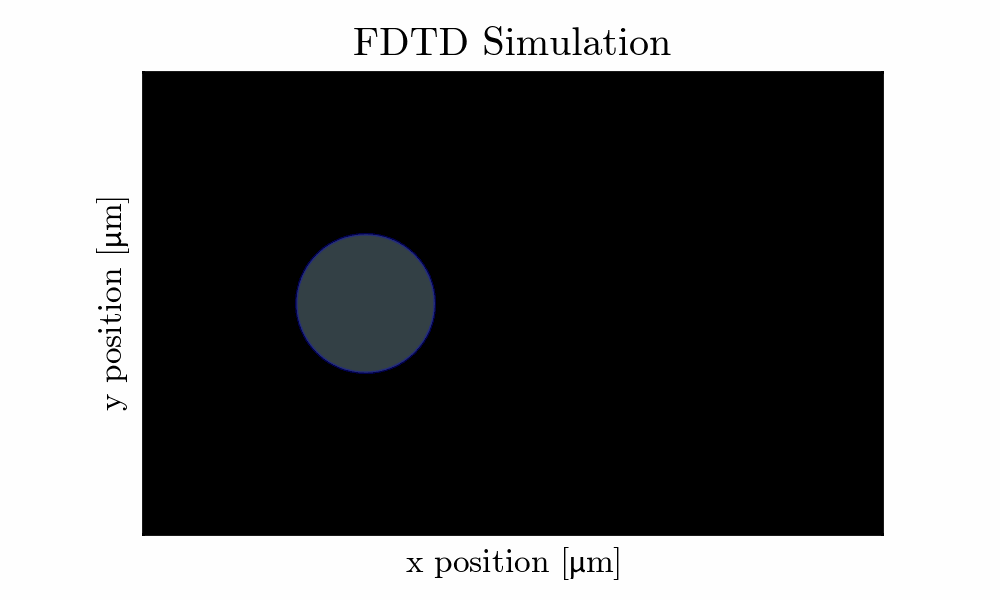

LightWave2D usage guide
=======================

Spherical scatterer
-------------------

.. code:: python

    from LightWave2D.grid import Grid
    from LightWave2D.experiment import Experiment
    from MPSPlots import colormaps
    from TypedUnit import ureg

    grid = Grid(
        resolution=0.1 * ureg.micrometer,
        size_x=32 * ureg.micrometer,
        size_y=20 * ureg.micrometer,
        n_steps=300
    )

   experiment = Experiment(grid=grid)

    scatterer = experiment.add_circle(
        position=('30%', '50%'),
        epsilon_r=2,
        radius=3 * ureg.micrometer
    )

    source = experiment.add_line_source(
        wavelength=1550 * ureg.nanometer,
        position_0=('10%', '100%'),
        position_1=('10%', '0%'),
        amplitude=10,
    )

   experiment.add_pml(order=1, width="10%", sigma_max=5000 * ureg.siemens / ureg.meter)

   experiment.run()

   animation = experiment.render_propagation(
       skip_frame=5,
       colormap=colormaps.polytechnique.red_black_blue
   )

   animation.save('./spherical_scatterer.gif', writer='Pillow', fps=10)

|example_scatterer|

Ring resonator
--------------

.. code:: python

   from LightWave2D.grid import Grid
   from LightWave2D.experiment import Experiment
   from MPSPlots.colormaps import polytechnique
   from TypedUnit import ureg

    grid = Grid(
        resolution=0.1 * ureg.micrometer,
        size_x=50 * ureg.micrometer,
        size_y=30 * ureg.micrometer,
        n_steps=800
    )

   experiment = Experiment(grid=grid)

    scatterer = experiment.add_ring_resonator(
        position=('35%', '50%'),
        epsilon_r=1.5,
        inner_radius=4 * ureg.micrometer,
        width=2 * ureg.micrometer
    )

    source = experiment.add_point_source(
        wavelength=1550 * ureg.nanometer,
        position=('25%', '50%'),
        amplitude=100,
    )

   experiment.add_pml(order=1, width="10%", sigma_max=5000 * ureg.siemens / ureg.meter)

   experiment.run()

   animation = experiment.render_propagation(skip_frame=5, colormap=polytechnique.red_black_blue)

   animation.save('./resonator.gif', writer='Pillow', fps=10)

|example_resonator|

Lens
----

.. code:: python

   from LightWave2D.grid import Grid
   from LightWave2D.experiment import Experiment
   from MPSPlots import colormaps
   from TypedUnit import ureg

    grid = Grid(
        resolution=0.1 * ureg.micrometer,
        size_x=60 * ureg.micrometer,
        size_y=30 * ureg.micrometer,
        n_steps=1200
    )

   experiment = Experiment(grid=grid)

    scatterer = experiment.add_lens(
        position=('35%', '50%'),
        epsilon_r=2,
        curvature=10 * ureg.micrometer,
        width=5 * ureg.micrometer
    )

    source = experiment.add_point_source(
        wavelength=1550 * ureg.nanometer,
        position=('10%', '50%'),
        amplitude=10,
    )

   experiment.add_pml(order=1, width="10%", sigma_max=5000 * ureg.siemens / ureg.meter)

   experiment.run()

   experiment.plot_frame(
       frame_number=-1,
       enhance_contrast=5,
       colormap=colormaps.polytechnique.red_black_blue
   )

   animation = experiment.render_propagation(
       skip_frame=5,
       colormap=colormaps.polytechnique.red_black_blue
   )

   animation.save('./lens.gif', writer='Pillow', fps=10)

|example_lens|

Plenty of other examples are available online; see the `examples <https://martinpdes.github.io/LightWave2D/gallery.html>`_
section of the documentation.

Testing
*******

To test locally (with cloning the GitHub repository) you'll need to install the dependencies and run the coverage command as

.. code:: python

   >>> git clone https://github.com/MartinPdeS/LightWave2D.git
   >>> cd LightWave2D
   >>> pip install -r requirements/requirements.txt
   >>> coverage run --source=LightWave2D --module pytest --verbose tests
   >>> coverage report --show-missing

Contributing
************

Contributions are welcome! Feel free to open an issue or submit a pull request on GitHub.

----

Contact Information
*******************

As of 2024 the project is still under development if you want to collaborate it would be a pleasure. I encourage you to contact me.

LightWave2D was written by `Martin Poinsinet de Sivry-Houle <https://github.com/MartinPdS>`_  .

Email:`martin.poinsinet-de-sivry@polymtl.ca <mailto:martin.poinsinet-de-sivry@polymtl.ca?subject=LightWave2D>`_ .

.. |example_resonator| image:: https://github.com/MartinPdeS/LightWave2D/blob/master/docs/images/resonator.gif?raw=true
   :alt: some image
   :class: with-shadow float-left
   :width: 800px

